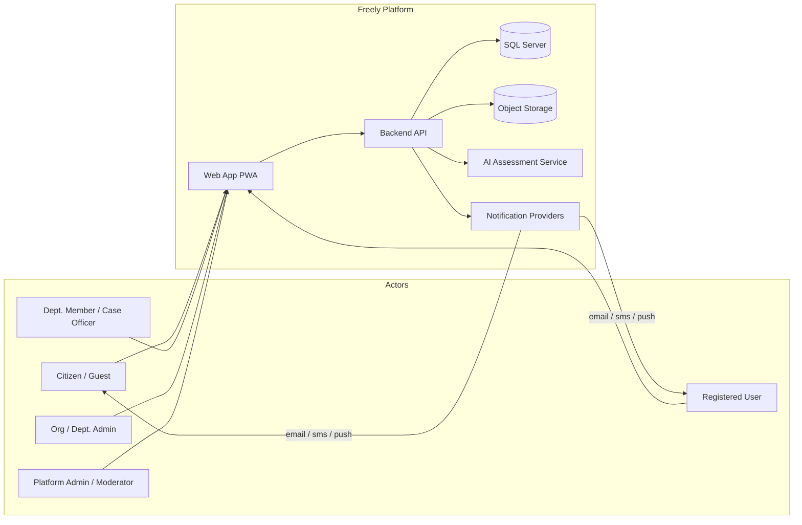
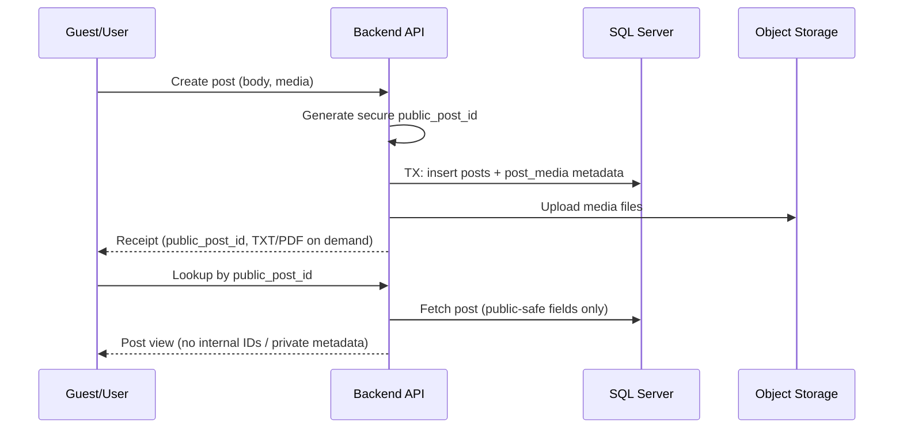
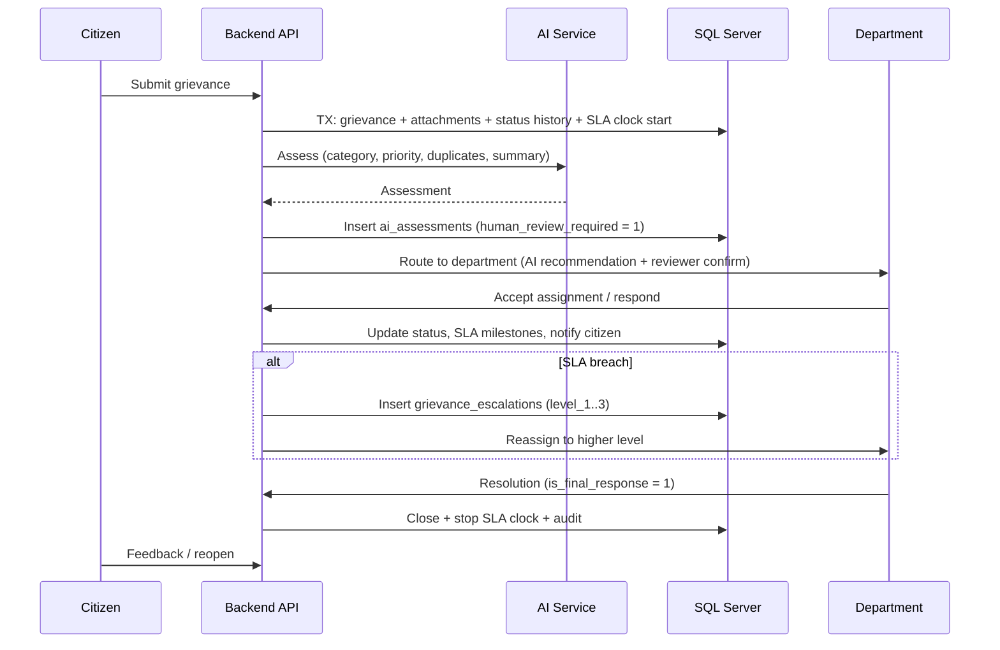
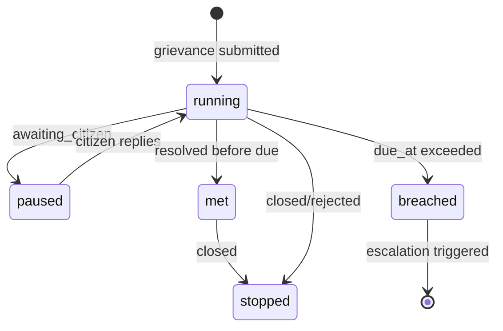
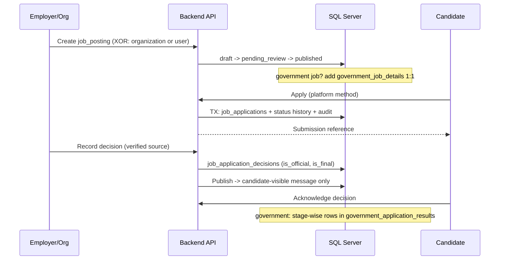
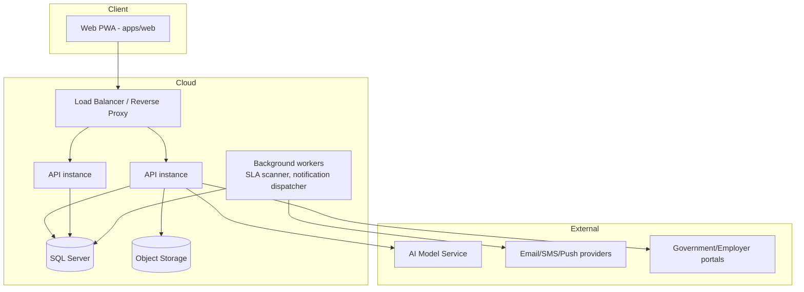

# Freely — High-Level Design (HLD)

| | |
|---|---|
| **Document** | High-Level Design |
| **Project** | Freely — Professional social network & microblogging platform with grievance management |
| **Source of truth** | `freely.dbml` |
| **Database** | Microsoft SQL Server |
| **Version** | 1.0 |
| **Date** | 2026-10-18 |
| **Status** | Draft |

---

## 1. Introduction

### 1.1 Purpose

This document describes the **high-level architecture** of the Freely platform as derived from the
database schema defined in `freely.dbml`. It is intended for architects,
developers, and reviewers who need a system-level understanding before reading the companion
Low-Level Design (LLD).

### 1.2 Scope

Freely combines four product pillars in one platform:

1. **Professional social network / microblogging** — posts, replies, quotes, likes, reposts,
   bookmarks, comments, hashtags, mentions, follows, and view tracking.
2. **Organizational identity & access control** — organizations, hierarchical departments,
   organization/department roles, memberships, and platform-wide roles.
3. **Grievance management** — citizen grievance submission, AI-assisted triage, department
   assignment, SLA monitoring, escalation, responses, feedback, and full auditing.
4. **Jobs & recruitment** — job postings (government, private, individual, NGO), government
   vacancy details, receipt auditing, candidate profiles, applications, decisions, and
   stage-wise government results.

### 1.3 Definitions

| Term | Meaning |
|---|---|
| **Public post ID** | Cryptographically secure random identifier (`posts.public_post_id`) used for anonymous post lookup and receipts. Never the sequential DB ID. |
| **Anonymous post** | A post with `is_anonymous = 1`. Guest posts have `author_user_id = NULL`; registered users posting anonymously retain `author_user_id` internally. |
| **SLA clock** | Per-grievance countdown (`grievance_sla`) driven by an `sla_policies` row; states: running, paused, met, breached, stopped. |
| **Escalation** | Movement of a grievance to a higher level (`level_1`–`level_3`) when SLA or manual triggers fire. |
| **Receipt (jobs)** | An immutable event row (`job_receipts`) recording that job information was received from a source organization. |
| **Employer XOR** | A job posting must have exactly one employer owner: `organization_id` **or** `employer_user_id`. |

---

## 2. System Context

**External systems:**

- **Object / file storage** — avatars, covers, post media, grievance attachments, resumes,
  result documents. Only metadata and `storage_key` values are persisted in SQL Server.
- **AI / ML service** — category prediction, priority prediction, sentiment, urgency scoring,
  duplicate detection, summarization, and department recommendation for grievances.
- **Notification providers** — email, SMS, and push gateways (tracked per-message in `notifications`).
- **Government / employer portals** — trusted sources for application status, decisions, and
  stage-wise recruitment results (imported or manually recorded).

---

## 3. Technology Stack

| Layer | Technology |
|---|---|
| Frontend | React 19 + Vite 8 + TypeScript (PWA), Tailwind CSS 4 + shadcn/ui, Redux Toolkit, react-router-dom 7, axios |
| Monorepo | Turborepo 2 + npm workspaces (`apps/*`, `packages/*`) |
| Backend | Python + **FastAPI** under `backend/` (MVC + OOP: controllers → services → repositories → models; SQLAlchemy 2 + pyodbc; Swagger UI at `/docs`; multi-table writes in transactions) |
| Database | Microsoft SQL Server (`datetime2`, UTC via `SYSUTCDATETIME()`, `ISJSON()` validation) |
| File storage | Protected object storage; DB stores only storage keys |
| AI | External model service; results persisted in `ai_assessments` with model name/version |

---

## 4. Module Decomposition

The schema is organized into 9 schema sections (8 functional domains + FK map). Each maps to a
backend module.

| # | Module | Core tables | Responsibility |
|---|---|---|---|
| 1 | **Identity, Organizations & Access** | `users`, `organizations`, `organization_roles`, `organization_memberships`, `departments`, `department_roles`, `department_memberships`, `platform_roles`, `user_platform_roles` | Accounts, org/dept hierarchy, role-based permissions, platform administration |
| 2 | **Social Graph & Microblogging** | `user_follows`, `posts`, `post_media`, `post_likes`, `post_reposts`, `post_bookmarks`, `post_comments`, `comment_likes`, `hashtags`, `post_hashtags`, `post_mentions`, `post_views` | Timeline content, social interactions, anonymous posting & public lookup |
| 3 | **Grievances** | `grievance_categories`, `grievances`, `grievance_attachments`, `post_grievance_links` | Grievance intake, categorization, evidence, social discussion linkage |
| 4 | **AI Assessment** | `ai_assessments` | Automated triage of grievances with human review gate |
| 5 | **Workflow** | `grievance_assignments`, `grievance_status_history`, `grievance_responses` | Assignment lifecycle, status transitions, official responses |
| 6 | **SLA & Escalation** | `sla_policies`, `grievance_sla`, `grievance_escalations` | Deadline computation, clock management, level-based escalation |
| 7 | **Notifications, Feedback & Audit** | `notifications`, `grievance_feedback`, `audit_logs` | Multi-channel messaging, citizen feedback, immutable audit trail |
| 8 | **Jobs & Recruitment** | `job_postings`, `government_job_details`, `job_receipts`, `candidate_profiles`, `job_applications`, `job_application_status_history`, `job_application_decisions`, `government_application_results`, `job_decision_acknowledgements`, `saved_jobs` | Job listings, government vacancies, receipt auditing, applications, decisions, results |

### 4.1 Entity overview

```mermaid
erDiagram
    users ||--o{ organization_memberships : "joins"
    organizations ||--o{ organization_roles : "defines"
    organizations ||--o{ departments : "contains"
    departments ||--o{ department_roles : "defines"
    departments ||--o{ department_memberships : "staffs"
    users ||--o{ department_memberships : "belongs"
    users ||--o{ posts : "authors"
    posts ||--o{ post_comments : "has"
    posts ||--o{ post_grievance_links : "discusses"
    grievances ||--o{ post_grievance_links : "linked by"
    grievances ||--o{ ai_assessments : "assessed by"
    grievances ||--o{ grievance_assignments : "assigned via"
    grievances ||--o{ grievance_status_history : "tracked by"
    grievances ||--o{ grievance_sla : "clocked by"
    grievances ||--o{ grievance_escalations : "escalated via"
    sla_policies ||--o{ grievance_sla : "governs"
    grievances ||--o{ grievance_responses : "answered by"
    grievances ||--o{ grievance_attachments : "evidenced by"
    grievances ||--o{ grievance_feedback : "rated by"
    users ||--o{ job_applications : "applies"
    job_postings ||--o{ job_applications : "receives"
    job_postings ||--|| government_job_details : "extends"
    job_postings ||--o{ job_receipts : "sourced by"
    job_applications ||--o{ job_application_decisions : "decided by"
    job_applications ||--o{ government_application_results : "results"
```

---

## 5. Key Architectural Decisions

| # | Decision | Rationale |
|---|---|---|
| AD-1 | **Single SQL Server database** with clearly separated schema sections | Strong consistency for multi-entity workflows (grievance + SLA + status history + audit in one transaction). |
| AD-2 | **Enums as `NVARCHAR` + CHECK constraints** | SQL Server has no native enum; values documented in DBML notes and enforced at DB + application layers. |
| AD-3 | **UTC everywhere** (`SYSUTCDATETIME()`, `datetime2`) | Avoids timezone ambiguity for SLA deadlines, which is legally significant for grievance resolution. |
| AD-4 | **Files in object storage; metadata in DB** | Keeps the relational store lean; enables signed-URL access control for evidence/resumes. |
| AD-5 | **Secure random public identifiers** (`public_post_id`, `public_job_id`, `tracking_number`) | Sequential IDs are never exposed publicly; prevents enumeration of anonymous posts/jobs. |
| AD-6 | **Anonymity is a display flag, not data deletion** | `is_anonymous` hides identity publicly while `author_user_id`/`user_id` remain for internal accountability and moderation. |
| AD-7 | **Human review gate on AI** (`human_review_required` default 1) | AI recommendations are advisory until a reviewer (`reviewed_by_user_id`) confirms. |
| AD-8 | **Immutable event rows** for receipts, status history, audit | History tables are append-only; corrections create new rows. |
| AD-9 | **Candidate-visible vs internal separation** in job decisions/history | `candidate_visible_reason`/`candidate_message` are publishable; `internal_notes` never leave the employer side. |
| AD-10 | **Scope validation in backend** (org/dept membership, manager compatibility) | Cross-organization access cannot be expressed fully in FKs; enforced in service layer. |

---

## 6. Core End-to-End Flows

### 6.1 Anonymous post creation & public lookup

**Rules:** creation + public ID generation in one transaction; lookup returns only fields allowed
for public viewing; the lookup ID is **not** an authorization secret (edit/delete requires a
separate high-entropy secret stored as a hash).

### 6.2 Grievance lifecycle

### 6.3 SLA clock & escalation

Escalation levels (`level_1` → `level_2` → `level_3`) move the grievance between departments or to
higher-authority users, recording reason, timestamps, and resolution notes.

### 6.4 Job posting → application → decision

---

## 7. Security Architecture

| Concern | Approach |
|---|---|
| Authentication | Registered users with `password_hash`; guest flows for anonymous posts (no account). |
| Authorization | Three tiers: **platform roles** (`platform_admin`, `moderation_admin`, `auditor`), **organization roles** (owner/admin/director/…), **department roles** (head, grievance manager, case officer, reviewer) with granular `can_*` flags. |
| Scope enforcement | Org/department scope validated in backend; `department_role` must belong to the membership's department; `manager_user_id` must be in a compatible scope. |
| Social visibility | `posts.visibility` (`public`, `followers`, `department`, `private`) enforced in backend queries. |
| Grievance access | Citizens see their own; departments see assigned scope; auditors see all (read). |
| Anonymity | Public projections strip author identity when `is_anonymous = 1`. |
| Data protection | Files behind protected storage with signed URLs; JSON audit payloads validated with `ISJSON()`. |
| Auditability | `audit_logs` captures actor, action, entity, old/new JSON values, IP address. |

---

## 8. Data Architecture

- **OLTP workload** in SQL Server with indexes tuned for feed queries (`created_at`),
  grievance queues (`status, priority`), SLA scans (`resolution_due_at`, `clock_status`),
  and job discovery (`job_type, status, published_at`).
- **Append-only tables** (`*_status_history`, `audit_logs`, `job_receipts`, `post_views`) are
  insert-heavy; candidates for partitioning by date at scale.
- **Soft delete** via `deleted_at` on `posts`, `post_comments`, `job_postings`.
- **Effective-dated configuration**: `sla_policies.effective_from/until` allows policy evolution
  without rewriting history.
- **Self-referencing hierarchies**: `departments.parent_department_id`,
  `grievance_categories.parent_category_id`, `post_comments.parent_comment_id`.

---

## 9. Non-Functional Requirements

| Category | Requirement |
|---|---|
| Performance | Timeline/feed reads served from indexed queries; anonymous lookup by unique `public_post_id` is O(1). |
| Scalability | Horizontal scaling of stateless API tier; DB scale-up first, then read replicas for feeds; object storage for media. |
| Availability | PWA shell for offline read; queued notifications with retry (`queued → sent → delivered/failed`). |
| Consistency | Multi-table writes (grievance + SLA + history + audit) in DB transactions. |
| Auditability | Every lifecycle/decision change writes an `audit_logs` row with before/after JSON. |
| Privacy | Anonymous identity never leaked in public APIs; internal notes never exposed to candidates. |
| Localization | `users.preferred_language` reserved for i18n. |

---

## 10. Deployment View

Background workers are required for: SLA breach detection, escalation triggering, notification
dispatch/retries, and importing external job/application status.

---

## 11. Risks & Assumptions

| # | Item | Type |
|---|---|---|
| R-1 | Backend must implement scope/visibility checks correctly — DB constraints alone are insufficient. | Risk |
| R-2 | SLA breach detection requires a reliable scheduler; missed runs delay escalations. | Risk |
| R-3 | AI predictions are advisory; workflow must tolerate absent/failed AI responses. | Risk |
| A-1 | SQL Server is the target engine (`SYSUTCDATETIME()`, `ISJSON()`, `datetime2`). | Assumption |
| A-2 | Guest grievance submission (no account) is out of scope of the current schema — `grievances.user_id` is NOT NULL. | Constraint |
| A-3 | `job_postings` migration (nullable `organization_id` + XOR CHECK) must follow the documented migration order. | Constraint |

---

## 12. References

- Database schema: `freely.dbml`
- Executable DDL (SQL Server): `backend/database/schema.sql`
- Backend application: `backend/` (FastAPI, Swagger UI at `/docs`)
- Companion document: `LLD-v1.0.md`
- Frontend structure: `PROJECT_STRUCTURE.md`
