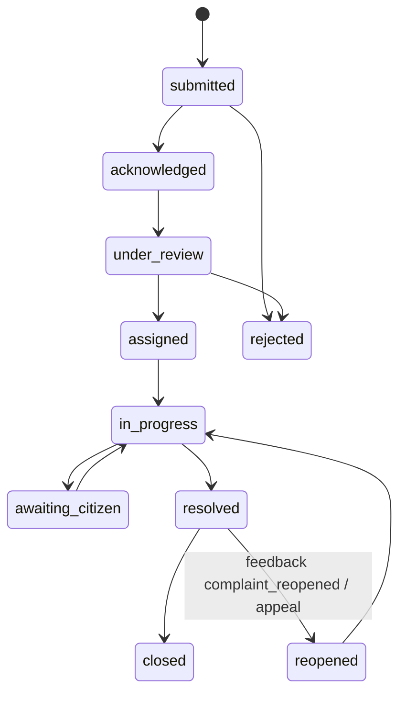
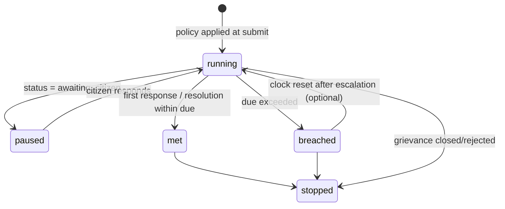
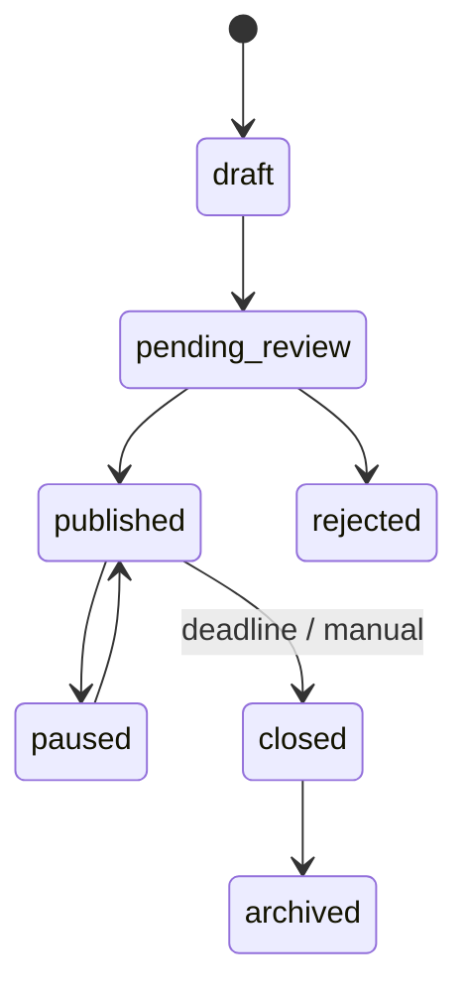
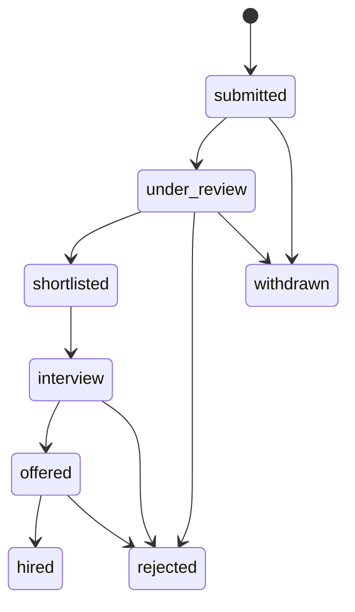

# Freely — Low-Level Design (LLD)

| | |
|---|---|
| **Document** | Low-Level Design |
| **Project** | Freely — Professional social network & microblogging platform with grievance management |
| **Source of truth** | `freely.dbml` |
| **Database** | Microsoft SQL Server |
| **Version** | 1.0 |
| **Date** | 2026-10-18 |
| **Status** | Draft |

> Companion to `HLD-v1.0.md`. This document details each module: tables, columns,
> enumerations, relationships, state machines, business rules, and the proposed REST API surface.

---

## 0. Global Conventions

| Convention | Rule |
|---|---|
| Timestamps | `datetime2`, UTC, default `SYSUTCDATETIME()`. `created_at` NOT NULL; `updated_at`/`deleted_at` nullable. |
| Enumerations | Stored as `NVARCHAR`, enforced by **CHECK constraints** in SQL Server and shared constants in the application (`packages/constants`). |
| Primary keys | `bigint IDENTITY` unless stated otherwise. |
| Public identifiers | `public_post_id`, `public_job_id`, `tracking_number` — cryptographically secure random strings generated **in the application**, never sequential IDs. |
| Files | Stored in protected object storage; DB persists `file_name`, `storage_key`, `mime_type`, `file_size_bytes`, optional `checksum`. |
| Soft delete | `deleted_at` on `posts`, `post_comments`, `job_postings`. Queries must filter `deleted_at IS NULL`. |
| Transactions | All multi-entity writes (e.g., grievance + SLA + history + audit) execute in a single DB transaction. |
| Scope checks | Organization/department compatibility enforced in backend services; DB FKs alone are insufficient. |
| JSON payloads | `audit_logs.old_values`/`new_values` validated with `ISJSON()`. |
| Audit | Lifecycle changes append `audit_logs` rows: `actor_user_id`, `action`, `entity_type`, `entity_id`, `old_values`, `new_values`, `ip_address`. |
| Backend layering | **FastAPI + MVC/OOP** under `backend/app/`: `controllers` (routers) → `services` (business logic, transactions) → `repositories` (data access) → `models` (SQLAlchemy ORM). Interactive Swagger UI at `/docs`; configuration via `backend/.env`. |

---

## 1. Module: Identity, Organizations & Access Control

### 1.1 Tables

#### `users`
| Column | Type | Constraints | Notes |
|---|---|---|---|
| id | bigint | PK, IDENTITY | |
| user_handle | nvarchar(50) | NOT NULL, UNIQUE | Public username, e.g. `@ayush` |
| full_name | nvarchar(150) | NOT NULL | |
| email | nvarchar(255) | UNIQUE | Nullable |
| phone | nvarchar(20) | UNIQUE | Nullable |
| password_hash | nvarchar(255) | | NULL for passwordless/guest-upgrade flows |
| bio | nvarchar(500) | | |
| avatar_storage_key / cover_storage_key | nvarchar(500) | | Object storage keys |
| website_url | nvarchar(500) | | |
| preferred_language | nvarchar(20) | | i18n hook |
| is_verified | bit | NOT NULL, default 0 | |
| is_active | bit | NOT NULL, default 1 | |
| created_at / updated_at | datetime2 | created NOT NULL default UTC | |

#### `organizations`
| Column | Type | Constraints | Notes |
|---|---|---|---|
| id | bigint | PK, IDENTITY | |
| name | nvarchar(200) | NOT NULL | |
| slug | nvarchar(220) | NOT NULL, UNIQUE | URL-safe identifier |
| organization_type | nvarchar(40) | NOT NULL, CHECK | `school`, `university`, `private_organization`, `government_organization`, `ngo`, `other` |
| description / address | nvarchar(max) | | |
| website_url, logo_storage_key, contact_email, contact_phone | — | | |
| city / state / country | nvarchar(100) | | |
| created_by_user_id | bigint | NOT NULL, FK → users | Founding user |
| verification_status | nvarchar(20) | NOT NULL, default `unverified`, CHECK | `unverified`, `pending`, `verified`, `rejected` |
| is_active | bit | NOT NULL, default 1 | |

**Indexes:** `organization_type`, `created_by_user_id`, `verification_status`, `is_active`.

#### `organization_roles`
Seeded per organization. Codes: `owner`, `organization_admin`, `director`, `ceo`, `md`.
Permission flags: `can_manage_organization`, `can_manage_departments`, `can_manage_members`,
`can_manage_organization_posts`.
**Unique:** `(organization_id, code)`. **Rule:** titles alone grant no privileges — flags decide.

#### `organization_memberships`
| Column | Notes |
|---|---|
| organization_id / user_id / organization_role_id | FKs; UNIQUE `(organization_id, user_id)` |
| membership_status | CHECK: `active`, `invited`, `suspended`, `ended`; default `active` |
| is_primary | User's primary organization |
| start_date / end_date | Employment window |

#### `departments`
Hierarchical (`parent_department_id` self-FK). UNIQUE `(organization_id, code)`.
Columns: `name`, `code`, `description`, `contact_email`, `contact_phone`, `is_active`.

#### `department_roles`
Per-department roles: Department Head, Grievance Manager, Case Officer, Reviewer.
| Flag / field | Meaning |
|---|---|
| permission_level | Application-defined tier (default 10); granular checks via flags |
| can_manage_members | Add/remove department members |
| can_manage_grievances | Assign, respond, change status |
| can_review_ai | Confirm/reject AI assessments |
| can_manage_sla | Pause/configure SLA clocks |
| can_audit | Read audit logs |

UNIQUE `(department_id, code)`.

#### `department_memberships`
| Column | Notes |
|---|---|
| (user_id, department_id) | UNIQUE pair |
| department_role_id | FK — **must belong to the same department as the membership** (backend-validated) |
| manager_user_id | FK → users; must belong to a compatible org/dept scope |
| job_title, employee_number | |
| membership_status | `active`, `invited`, `suspended`, `ended` |
| is_primary | Default 1 |

#### `platform_roles` / `user_platform_roles`
Platform-wide roles (`platform_admin`, `moderation_admin`, `auditor`).
`user_platform_roles` composite PK `(user_id, platform_role_id)`; records `assigned_by_user_id`.

### 1.2 Business rules

1. A user may hold multiple organization memberships; exactly one should be `is_primary = 1`.
2. Role seeding: on organization creation, insert default `organization_roles` rows and assign
   the creator as `owner` — in one transaction.
3. Department role ↔ membership department consistency is validated in the service layer.
4. `ended`/`suspended` memberships deny access immediately; checks use `membership_status`.

### 1.3 Proposed API surface

| Method & path | Purpose | Permission |
|---|---|---|
| `POST /api/v1/users` | Register user | Public |
| `GET /api/v1/users/{handle}` | Public profile | Public |
| `PATCH /api/v1/users/me` | Update own profile | Self |
| `POST /api/v1/organizations` | Create organization (+ seed roles, owner membership) | Authenticated |
| `GET /api/v1/organizations/{slug}` | Organization profile | Public |
| `PATCH /api/v1/organizations/{id}` | Update organization | `can_manage_organization` |
| `POST /api/v1/organizations/{id}/departments` | Create department | `can_manage_departments` |
| `POST /api/v1/organizations/{id}/members` | Invite/add member | `can_manage_members` |
| `PATCH /api/v1/department-memberships/{id}` | Change role/status/manager | `can_manage_members` (dept) |
| `POST /api/v1/admin/users/{id}/platform-roles` | Grant platform role | `platform_admin` |

---

## 2. Module: Social Graph & Microblogging

### 2.1 Tables

#### `user_follows`
Composite PK `(follower_user_id, followed_user_id)`; index on `followed_user_id`, `created_at`.
Rule: follower ≠ followed (CHECK).

#### `posts`
| Column | Type | Constraints | Notes |
|---|---|---|---|
| id | bigint | PK, IDENTITY | Internal only |
| author_user_id | bigint | FK → users, NULLABLE | NULL = guest post |
| public_post_id | nvarchar(40) | NOT NULL, UNIQUE | Secure random; printed on receipts |
| is_anonymous | bit | NOT NULL, default 0 | 1 = hide registered author publicly; guest posts always 1 |
| body | nvarchar(max) | NOT NULL | |
| post_type | nvarchar(20) | default `post`, CHECK | `post`, `reply`, `quote` |
| visibility | nvarchar(20) | default `public`, CHECK | `public`, `followers`, `department`, `private` |
| reply_to_post_id / quote_post_id | bigint | self-FKs | |
| is_sensitive / is_pinned | bit | defaults 0 | |
| moderation_status | nvarchar(20) | default `visible`, CHECK | `visible`, `hidden`, `removed`, `under_review` |
| created_at / updated_at / deleted_at | datetime2 | soft delete via `deleted_at` | |

**Indexes:** `author_user_id`, `created_at`, `(visibility, created_at)`, `reply_to_post_id`,
`quote_post_id`, `moderation_status`.

#### Interaction tables
| Table | PK / key | Notes |
|---|---|---|
| `post_media` | id PK | `media_type` CHECK `image`/`video`/`document`; `sort_order`; guest uploads have NULL `uploaded_by_user_id` |
| `post_likes` | (post_id, user_id) | Toggle semantics in service |
| `post_reposts` | (post_id, user_id) | `repost_type`: `repost`, `quote`; optional `quote_post_id` |
| `post_bookmarks` | (post_id, user_id) | Private to user |
| `post_comments` | id PK | Threaded via `parent_comment_id`; own `moderation_status`; soft delete |
| `comment_likes` | (comment_id, user_id) | |
| `hashtags` + `post_hashtags` | tag UNIQUE; (post_id, hashtag_id) | Extracted from body at write time |
| `post_mentions` | UNIQUE (post_id, mentioned_user_id) | Drives mention notifications |
| `post_views` | id PK | `viewer_user_id` NULL for anonymous; `anonymous_view_key` for dedupe |

### 2.2 Visibility & moderation rules

| Visibility | Readable by |
|---|---|
| `public` | Everyone (subject to `moderation_status = visible`) |
| `followers` | Author + followers |
| `department` | Members of the author's department scope |
| `private` | Author only |

- Registered anonymous posts appear on the author's profile **only when** `is_anonymous = 0`.
- Public lookup by `public_post_id` returns public-safe fields only; internal IDs and private
  metadata are stripped. The lookup ID is **not** an authorization secret — guest edit/delete
  requires a separate high-entropy secret stored as a hash.
- Receipts (TXT/PDF) are generated on demand; persist only if receipt history is required.

### 2.3 Proposed API surface

| Method & path | Purpose | Permission |
|---|---|---|
| `POST /api/v1/posts` | Create post (guest or authenticated); TX: post + media + hashtags + mentions | Public (rate-limited) |
| `GET /api/v1/posts/lookup/{publicPostId}` | Anonymous post lookup | Public |
| `GET /api/v1/feed` | Timeline (visibility-filtered) | Authenticated |
| `DELETE /api/v1/posts/{id}` | Soft delete | Author / moderator |
| `POST /api/v1/posts/{id}/likes` | Like/unlike | Authenticated |
| `POST /api/v1/posts/{id}/reposts` | Repost/quote | Authenticated |
| `POST /api/v1/posts/{id}/bookmarks` | Bookmark | Authenticated |
| `POST /api/v1/posts/{id}/comments` | Comment | Per post visibility |
| `POST /api/v1/users/{id}/follow` | Follow/unfollow | Authenticated |
| `POST /api/v1/moderation/posts/{id}` | Set moderation_status | `moderation_admin` |

---

## 3. Module: Grievances

### 3.1 Tables

#### `grievance_categories`
Self-hierarchy via `parent_category_id`; `code` UNIQUE; `default_department_id` FK → departments
(used for routing fallback). `is_active` flag.

#### `grievances`
| Column | Type | Constraints | Notes |
|---|---|---|---|
| id | bigint | PK | |
| tracking_number | nvarchar(40) | NOT NULL, UNIQUE | Citizen-facing reference |
| user_id | bigint | NOT NULL, FK → users | Submitting citizen (guest submission is out of scope — see HLD A-2) |
| category_id | bigint | NOT NULL, FK | |
| title | nvarchar(250) | NOT NULL | |
| description | nvarchar(max) | NOT NULL | |
| location_text / address / district / state / postal_code | — | | |
| latitude / longitude | decimal(10,7) | | Optional geolocation |
| status | nvarchar(40) | default `submitted`, CHECK | see state machine |
| priority | nvarchar(20) | default `medium`, CHECK | `low`, `medium`, `high`, `critical` |
| is_anonymous | bit | default 0 | Hides identity publicly; `user_id` retained internally |
| submitted_at / acknowledged_at / resolved_at / closed_at / reopened_at | datetime2 | milestone timestamps | |

**Indexes:** `user_id`, `category_id`, `status`, `priority`, `submitted_at`, `(status, priority)`.

#### `grievance_attachments`
`grievance_id` FK, `uploaded_by_user_id` FK, file metadata, `checksum`, `is_evidence` flag.

#### `post_grievance_links`
Composite PK `(post_id, grievance_id)`; `link_type` CHECK: `discussion`, `official_update`,
`evidence_context`; records `linked_by_user_id`. Bridges social discussion and case management.

### 3.2 Grievance state machine



| Trigger | Transition | Side effects (single TX) |
|---|---|---|
| Submit | → `submitted` | Insert grievance + attachments, start SLA clock, status history row, audit row, notify citizen |
| Acknowledge | → `acknowledged` | Set `acknowledged_at`, history, notification |
| Assign | → `assigned` | Insert `grievance_assignments`, history, notify assignee |
| Request info | → `awaiting_citizen` | **Pause SLA clock** (`paused_at`) |
| Citizen reply | → `in_progress` | Resume clock; accumulate `total_paused_minutes` |
| Resolve | → `resolved` | `resolved_at`, `is_final_response = 1` response, SLA `met`/`stopped` |
| Reopen | → `reopened` | `reopened_at`, new SLA evaluation |
| Close / Reject | → `closed` / `rejected` | SLA `stopped`, final notification, audit |

Every transition appends to `grievance_status_history` with `previous_status`, `new_status`,
`changed_by_user_id`, `change_reason`, `is_public`.

### 3.3 Proposed API surface

| Method & path | Purpose | Permission |
|---|---|---|
| `POST /api/v1/grievances` | Submit grievance (TX bundle above) | Authenticated |
| `GET /api/v1/grievances/{trackingNumber}` | Public tracking (safe fields) | Public |
| `GET /api/v1/grievances/mine` | Citizen's own list | Owner |
| `GET /api/v1/departments/{id}/grievances?status=&priority=` | Department queue | `can_manage_grievances` |
| `POST /api/v1/grievances/{id}/status` | Transition status (validates state machine) | Dept role |
| `POST /api/v1/grievances/{id}/attachments` | Add evidence | Owner / dept |
| `POST /api/v1/grievances/{id}/links` | Link/unlink post (`link_type`) | Authenticated |

---

## 4. Module: AI Assessment

### 4.1 Table: `ai_assessments`

| Column | Notes |
|---|---|
| grievance_id | FK; multiple assessments allowed per grievance (re-runs) |
| model_name / model_version | Provenance — required for auditability |
| predicted_category_id | FK → grievance_categories |
| predicted_priority | `low`/`medium`/`high`/`critical` |
| sentiment_label | e.g. negative/neutral/positive |
| urgency_score / confidence_score | decimal(5,4) — 0..1 |
| duplicate_of_grievance_id | Self-FK for duplicate detection |
| summary | Generated summary |
| recommended_department_id / recommendation_reason | Routing suggestion |
| human_review_required | **Default 1** — gate before acting on AI output |
| reviewed_by_user_id / reviewed_at | Human review record |

### 4.2 Rules

1. AI runs asynchronously after submission; failure must not block the grievance (fallback:
   category `default_department_id` routing).
2. A reviewer with `can_review_ai` confirms or overrides: category, priority, department.
3. Overrides write an audit row; the AI row itself stays immutable for later model evaluation.

### 4.3 API

| Method & path | Purpose | Permission |
|---|---|---|
| `POST /api/v1/internal/grievances/{id}/assess` | Trigger assessment (service-to-service) | Internal |
| `GET /api/v1/grievances/{id}/assessments` | List assessments | Dept role |
| `POST /api/v1/ai-assessments/{id}/review` | Confirm/override | `can_review_ai` |

---

## 5. Module: Workflow — Assignments, Status History, Responses

### 5.1 Tables

#### `grievance_assignments`
| Column | Notes |
|---|---|
| grievance_id / department_id | FKs — department is mandatory |
| assigned_to_user_id | Nullable until a specific officer is chosen |
| assigned_by_user_id | Who made the assignment |
| assignment_status | CHECK: `assigned`, `accepted`, `transferred`, `completed`, `cancelled`; default `assigned` |
| assignment_reason | |
| assigned_at / accepted_at / completed_at | |
| transfer_from_assignment_id | Self-FK — transfer chain |

Indexes: `grievance_id`, `department_id`, `assigned_to_user_id`, `assignment_status`.

**Transfer rule:** transferring inserts a **new** assignment row referencing
`transfer_from_assignment_id`; the old row becomes `transferred`. Never mutate in place.

#### `grievance_status_history`
Append-only. `previous_status` NULL on the first row. `is_public` controls citizen visibility.

#### `grievance_responses`
| Column | Notes |
|---|---|
| response_type | CHECK: `acknowledgement`, `clarification_request`, `progress_update`, `resolution`, `rejection` |
| assignment_id | Optional link to the assignment under which the response was made |
| is_public | Citizen-visible flag |
| is_final_response | Marks the resolution response |
| related_post_id | Optional link to an official update post |

### 5.2 API

| Method & path | Purpose | Permission |
|---|---|---|
| `POST /api/v1/grievances/{id}/assignments` | Assign to dept/officer | `can_manage_grievances` |
| `POST /api/v1/assignments/{id}/accept` | Officer accepts | Assignee |
| `POST /api/v1/assignments/{id}/transfer` | Transfer (new row + chain) | `can_manage_grievances` |
| `GET /api/v1/grievances/{id}/history` | Status timeline (public-filtered for citizens) | Owner / dept |
| `POST /api/v1/grievances/{id}/responses` | Add response | Dept role |

---

## 6. Module: SLA & Escalation

### 6.1 Tables

#### `sla_policies`
| Column | Notes |
|---|---|
| category_id / department_id | Nullable FKs — policy can target category, department, or both |
| priority | NOT NULL — policy is per-priority |
| acknowledgement_minutes / response_minutes / resolution_minutes | Deadline components |
| working_hours_only | If 1, deadline computation skips non-working hours (backend calendar logic) |
| escalation_after_minutes | Auto-escalation threshold |
| effective_from / effective_until / is_active | Effective-dated policies |

**Resolution rule:** pick the most specific active policy matching `(department_id, category_id,
priority)` effective at `submitted_at`; fall back to broader policies.

#### `grievance_sla`
One active clock per grievance.
| Column | Notes |
|---|---|
| acknowledgement_due_at / first_response_due_at / resolution_due_at | Computed at submission |
| first_responded_at / actual_resolved_at | Actuals |
| clock_status | CHECK: `running`, `paused`, `met`, `breached`, `stopped` |
| paused_at / total_paused_minutes | Pause accounting (e.g., `awaiting_citizen`) |
| breached_at / breach_reason | Breach record |

Indexes: `grievance_id`, `resolution_due_at`, `clock_status` — the SLA scanner queries
`clock_status = 'running' AND resolution_due_at < SYSUTCDATETIME()`.

#### `grievance_escalations`
| Column | Notes |
|---|---|
| level | CHECK: `level_1`, `level_2`, `level_3` |
| from_department_id / to_department_id / assigned_to_user_id | Routing |
| sla_id | Nullable link to the breached clock |
| status | CHECK: `pending`, `acknowledged`, `resolved`, `dismissed` |
| triggered_at / acknowledged_at / resolved_at / resolution_note | |

### 6.2 Clock state machine



### 6.3 Background processing

1. **SLA scanner (worker):** periodically selects running clocks past due; sets `breached`,
   records `breached_at`/`breach_reason`, and inserts a `grievance_escalations` row at the next
   level — all in one transaction, then dispatches notifications.
2. **Escalation levels:** `level_1` → department head; `level_2` → parent department / org admin;
   `level_3` → platform-level authority.

### 6.4 API

| Method & path | Purpose | Permission |
|---|---|---|
| `GET /api/v1/sla-policies?departmentId=&categoryId=` | List policies | Dept admin |
| `POST /api/v1/sla-policies` | Create policy | `can_manage_sla` |
| `GET /api/v1/grievances/{id}/sla` | Clock status | Owner / dept |
| `POST /api/v1/grievances/{id}/sla/pause` / `resume` | Manual pause | `can_manage_sla` |
| `GET /api/v1/escalations?status=pending` | Escalation inbox | Escalation target |
| `POST /api/v1/escalations/{id}/acknowledge` / `resolve` / `dismiss` | Escalation handling | Target dept |

---

## 7. Module: Notifications, Feedback & Audit

### 7.1 Tables

#### `notifications`
| Column | Notes |
|---|---|
| recipient_user_id | FK (in-app identity; channel routing resolved from user contact fields) |
| grievance_id / post_id | Optional context links |
| channel | CHECK: `email`, `sms`, `in_app`, `push` |
| status | CHECK: `queued`, `sent`, `delivered`, `failed`; default `queued` |
| template_key / subject / message | Template-driven content |
| provider_message_id | Gateway correlation |
| sent_at / delivered_at / read_at | Lifecycle timestamps |

Dispatcher worker: picks `queued` rows, sends via provider, transitions status; retries `failed`
with backoff. `read_at` applies to `in_app`.

#### `grievance_feedback`
`feedback_type` CHECK: `satisfaction`, `complaint_reopened`, `appeal`; `rating` (e.g., 1–5);
optional `response_id` FK. `complaint_reopened`/`appeal` trigger the `reopened` transition.

#### `audit_logs`
| Column | Notes |
|---|---|
| grievance_id | Optional context |
| actor_user_id | NULL for system/guest actions |
| action | e.g. `created`, `updated`, `published`, `decision_published`, `result_imported` |
| entity_type / entity_id | e.g. `job_posting`, `grievance`, `job_application_decision` |
| old_values / new_values | JSON (`ISJSON()` validated) |
| ip_address | varchar(45) — IPv6-safe |

Indexes: `grievance_id`, `(entity_type, entity_id)`, `created_at`. Append-only; `can_audit`
(department) or `auditor` (platform) required to read.

### 7.2 API

| Method & path | Purpose | Permission |
|---|---|---|
| `GET /api/v1/notifications?channel=in_app` | My notifications | Self |
| `POST /api/v1/notifications/{id}/read` | Mark read | Self |
| `POST /api/v1/grievances/{id}/feedback` | Submit feedback (may reopen) | Grievance owner |
| `GET /api/v1/audit-logs?entityType=&entityId=` | Audit search | `can_audit` / `auditor` |

---

## 8. Module: Jobs, Recruitment & Receipt Auditing

### 8.1 Tables

#### `job_postings`
| Column | Type | Constraints | Notes |
|---|---|---|---|
| id | bigint | PK | Internal only |
| public_job_id | nvarchar(40) | NOT NULL, UNIQUE | Secure random |
| job_type | nvarchar(30) | NOT NULL, CHECK | `government`, `private`, `individual`, `ngo`, `other` |
| organization_id | bigint | FK, NULLABLE | Employer org |
| employer_user_id | bigint | FK, NULLABLE | Individual employer |
| posted_by_user_id | bigint | NOT NULL, FK | Listing creator (may differ from employer) |
| title / description | — | NOT NULL | |
| employment_type | nvarchar(30) | CHECK | `full_time`, `part_time`, `contract`, `internship`, `temporary` |
| experience_level / workplace_type | — | workplace CHECK `onsite`/`hybrid`/`remote` | |
| city / state / country | | | |
| salary_min / salary_max / salary_currency / salary_period | decimal(18,2), nvarchar(3), nvarchar(20) | period CHECK `hourly`/`monthly`/`yearly` | |
| application_method | nvarchar(30) | default `platform`, CHECK | `platform`, `external_url`, `email`, `offline` |
| application_url / application_email | | | Required when method demands |
| status | nvarchar(30) | default `draft`, CHECK | `draft`, `pending_review`, `published`, `paused`, `closed`, `rejected`, `archived` |
| published_at / application_deadline | datetime2 | | |
| deleted_at | soft delete | | |

**Employer XOR CHECK** (apply only after existing rows are migrated):
```sql
CHECK ((organization_id IS NOT NULL AND employer_user_id IS NULL)
    OR (organization_id IS NULL AND employer_user_id IS NOT NULL))
```

Indexes: `(job_type, status, published_at)`, `organization_id`, `posted_by_user_id`,
`application_deadline`, `created_at`.

#### `government_job_details`
1:1 extension (`job_id` PK/FK). Fields: `recruitment_name`, `advertisement_number`,
`department_name`, `post_name`, `number_of_vacancies`, `eligibility_criteria`, `minimum_age`,
`maximum_age`, `educational_qualification`, `application_start_at`, `application_end_at`,
`examination_date`, `official_notification_url`, `official_application_url`.

#### `job_receipts` (immutable)
Each row = one receipt event from `source_organization_id` (may differ from employer).
| Column | Notes |
|---|---|
| received_by_user_id / received_at | |
| source_reference / source_url / receipt_batch_id | Provenance |
| receipt_method | `manual`, `email`, `api`, `import`, `other` |
| verification_status | `pending`, `verified`, `rejected`; default `pending` |

**Rule:** receipt rows are immutable — updates create new rows.

#### `candidate_profiles`
1:1 with `users` (`user_id` PK/FK). Headline, summary, experience months, resume key, links.
`profile_visibility` CHECK: `private`, `employers`, `public`.

#### `job_applications`
| Column | Notes |
|---|---|
| (job_posting_id, applicant_user_id) | UNIQUE — one application per candidate per job |
| resume_storage_key / cover_letter | Snapshot at apply time |
| application_method | Mirrors posting method |
| submission_status | CHECK: `recorded`, `submitted`, `acknowledged`, `failed`, `unverified` — **external/offline applications must not be assumed submitted** |
| submission_reference / submission_confirmed_at | External confirmation |
| status_source | CHECK: `platform`, `employer`, `government_portal`, `manual`, `imported` |
| last_status_verified_at | Freshness of external status |
| status | CHECK: `submitted`, `under_review`, `shortlisted`, `interview`, `offered`, `hired`, `rejected`, `withdrawn` |
| applied_at / withdrawn_at | |

#### `job_application_status_history`
Append-only transitions with `previous_status`/`new_status`, `changed_by_user_id`,
`change_reason`, `reason_code` (`eligibility`, `qualifications`, `experience`,
`incomplete_documents`, `exam_score`, `position_filled`, `other`), plus the visibility split:
`candidate_visible_reason` vs `internal_notes` (**never** exposed to candidates),
`is_candidate_visible` flag.

#### `job_application_decisions`
Candidate-facing decisions, separate from current status.
| Column | Notes |
|---|---|
| decision_type | CHECK: `selected`, `not_selected`, `waitlisted`, `conditional_offer`, `offer`, `hired`, `cancelled`, `pending` |
| candidate_message vs internal_notes | Publish-safe vs confidential |
| decision_source | `employer`, `government_portal`, `manual`, `imported` |
| is_official / is_final | Publish only verified/authorized decisions |
| decision_reference / decision_at / published_at | `published_at` set when shown to candidate |

#### `government_application_results`
Stage-wise results from trusted sources only.
- `recruitment_stage` CHECK: `application_screening`, `written_exam`, `prelims`, `mains`,
  `interview`, `skill_test`, `document_verification`, `merit_list`, `waiting_list`, `final_selection`
- `result_status` CHECK: `pending`, `qualified`, `not_qualified`, `selected`, `not_selected`,
  `waitlisted`, `absent`, `disqualified`
- Marks/rank: `marks_obtained`, `maximum_marks`, `rank_number`, `roll_number`
- Evidence: `result_reference`, `official_result_url`, `result_document_storage_key`
- `is_official` gate before publication (`published_at`)

#### `job_decision_acknowledgements`
Composite PK `(decision_id, user_id)` — records candidate acknowledgement of published decisions.

#### `saved_jobs`
Composite PK `(user_id, job_posting_id)`.

### 8.2 Job posting state machine



### 8.3 Application status machine



### 8.4 Migration guidance (existing `job_postings` rows)

1. Add `employer_user_id` nullable. 2. Alter `organization_id` to allow NULL.
3. Add FK `employer_user_id → users.id`. 4. Backfill so every row satisfies exactly-one-owner.
5. Add the XOR CHECK. 6. Backfill new application/history defaults. 7. Create decision,
   government-result, and acknowledgement tables.

### 8.5 API

| Method & path | Purpose | Permission |
|---|---|---|
| `POST /api/v1/jobs` | Create posting (+ gov details if `government`) | Employer / org member |
| `GET /api/v1/jobs?type=&status=published` | Job search | Public |
| `GET /api/v1/jobs/{publicJobId}` | Job detail | Public |
| `POST /api/v1/jobs/{id}/publish` / `pause` / `close` | Lifecycle | Employer |
| `POST /api/v1/jobs/{id}/receipts` | Record receipt event | Source org |
| `POST /api/v1/job-receipts/{id}/verify` | Verify/reject receipt | Platform reviewer |
| `GET /api/v1/candidate-profiles/me` / `PATCH` | Candidate profile | Self |
| `POST /api/v1/jobs/{id}/applications` | Apply (TX: application + history + audit) | Candidate |
| `POST /api/v1/applications/{id}/status` | Transition status (visibility-split reasons) | Employer |
| `POST /api/v1/applications/{id}/decisions` | Record decision | Employer |
| `POST /api/v1/decisions/{id}/publish` | Publish to candidate | Employer (verified only) |
| `POST /api/v1/decisions/{id}/acknowledge` | Acknowledge | Candidate |
| `POST /api/v1/applications/{id}/results` | Import stage result (government) | Trusted source |
| `POST /api/v1/jobs/{id}/save` | Save/unsave | Authenticated |

---

## 9. Cross-Cutting Design

### 9.1 Permission matrix (summary)

| Capability | Citizen | Org member | Dept role (flags) | Org admin | Platform admin |
|---|---|---|---|---|---|
| Post / interact socially | ✅ | ✅ | ✅ | ✅ | ✅ |
| Submit & track grievance | ✅ | ✅ | ✅ | ✅ | ✅ |
| Manage dept grievance queue | — | — | `can_manage_grievances` | ✅ | ✅ |
| Review AI assessments | — | — | `can_review_ai` | ✅ | ✅ |
| Manage SLA policies | — | — | `can_manage_sla` | ✅ | ✅ |
| Read audit logs | — | — | `can_audit` | ✅ | `auditor` |
| Moderate posts | — | — | — | — | `moderation_admin` |
| Manage org / depts / members | — | — | — | `can_manage_*` | ✅ |
| Publish jobs / decisions | — | Employer-side members | — | ✅ | ✅ |
| Verify receipts / grant roles | — | — | — | — | ✅ |

### 9.2 Transaction boundaries

| Operation | Tables in one TX |
|---|---|
| Create post | `posts`, `post_media`, `post_hashtags`, `post_mentions` |
| Submit grievance | `grievances`, `grievance_attachments`, `grievance_status_history`, `grievance_sla`, `audit_logs`, `notifications` |
| Status transition | `grievances`, `grievance_status_history`, `grievance_sla` (pause/resume), `audit_logs`, `notifications` |
| Assign / transfer | `grievance_assignments` (insert/update pair), `grievances` (status), `grievance_status_history`, `audit_logs` |
| SLA breach | `grievance_sla`, `grievance_escalations`, `notifications`, `audit_logs` |
| Apply for job | `job_applications`, `job_application_status_history`, `audit_logs`, `notifications` |
| Publish decision | `job_application_decisions`, `job_application_status_history`, `notifications`, `audit_logs` |

### 9.3 Indexing strategy

- **Feeds:** `posts(visibility, created_at)`, `post_views(viewed_at)`.
- **Grievance queues:** `grievances(status, priority)`, `grievances(submitted_at)`.
- **SLA scanner:** `grievance_sla(clock_status, resolution_due_at)` (query both indexed columns).
- **Jobs discovery:** `job_postings(job_type, status, published_at)`, deadline searches via
  `application_deadline`.
- **Lookups:** UNIQUE on `public_post_id`, `public_job_id`, `tracking_number`,
  `users.user_handle`, `organizations.slug`.

### 9.4 Notification triggers (minimum set)

| Event | Channels |
|---|---|
| Grievance submitted / acknowledged / resolved | in_app + email (sms for critical) |
| Assignment to officer | in_app + email |
| SLA breach / escalation | in_app + email + sms |
| Mention / reply / like (per user settings) | in_app (+ push) |
| Application status change / decision published | in_app + email |

---

## 10. References

- Database schema: `freely.dbml`
- High-level design: `HLD-v1.0.md`
- Frontend structure & conventions: `PROJECT_STRUCTURE.md`
